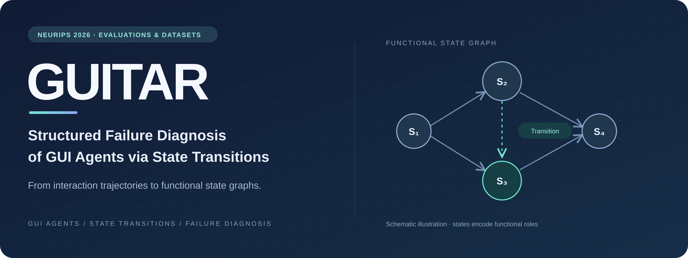
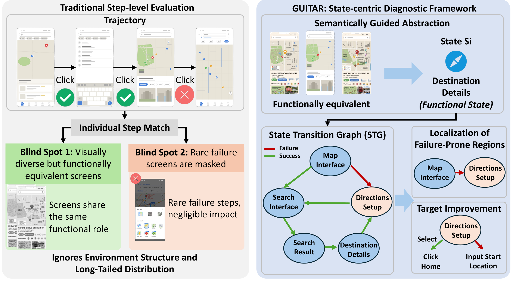
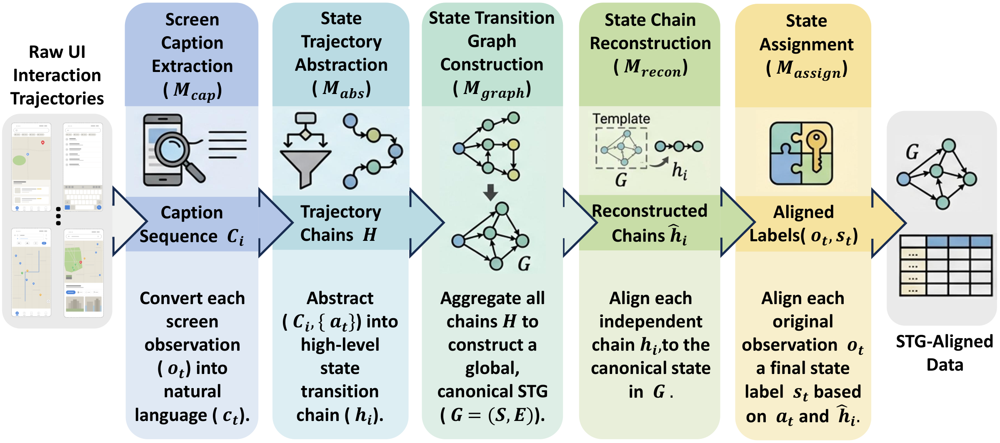

<h1 align="center">GUITAR</h1>
<p align="center">
  <strong>Structured Failure Diagnosis of GUI Agents via State Transitions</strong><br>
  NeurIPS 2026 · Evaluations &amp; Datasets Track
</p>

<p align="center">
  <a href="https://arxiv.org/abs/2609.34113"><strong>📄 Paper · arXiv:2609.34113</strong></a>
  &nbsp; | &nbsp;
  <a href="https://arxiv.org/pdf/2609.34113"><strong>Read PDF</strong></a>
</p>

<p align="center">
  <a href="#overview">Overview</a> ·
  <a href="#method">Method</a> ·
  <a href="#getting-started">Getting started</a> ·
  <a href="#run-the-pipeline">Usage</a> ·
  <a href="#code-map">Code map</a> ·
  <a href="#citation">Citation</a>
</p>

---

## Overview

**From GUI interaction trajectories to structured failure diagnosis.** GUITAR converts interaction traces into a functional **State Transition Graph (STG)**. Screens are grouped by their roles in task execution rather than visual appearance, allowing failures to be analyzed at both the state and transition levels.

| Functional states | Shared transition structure | Traceable annotations |
| :--- | :--- | :--- |
| Represent screens by their roles in a task. | Aggregate trajectory-level chains into a common STG. | Map original screenshots and observed actions back to states and transitions. |

This repository contains the research code for [GUITAR](https://arxiv.org/abs/2609.34113), the accepted NeurIPS 2026 paper. **Model weights and benchmark data are not included.**


*Figure 1 from the paper. From isolated step outcomes to structured failure diagnosis.*

[Full-resolution image](./assets/paper-overview.png) · [Original figure PDF](./assets/paper-overview.pdf)

## Method


*Figure 7 from the paper. The five-stage automatic STG construction pipeline.*

[Full-resolution image](./assets/paper-pipeline.png) · [Original figure PDF](./assets/paper-pipeline.pdf)

The pipeline builds a shared functional graph, then aligns the original trajectories and screenshots with its canonical states.

| Stage | Operation | Result |
| :--- | :--- | :--- |
| **01 · Caption** | Summarize each GUI screenshot in its trajectory context. | Context-aware screen descriptions |
| **02 · Abstract** | Convert each screenshot/action trajectory into a functional chain. | Trajectory-level states and transitions |
| **03 · Aggregate** | Merge chains into a global STG and parse it into JSON. | Shared states and edges |
| **04 · Reconstruct** | Align each trajectory with the canonical STG. | Reconstructed state-transition chains |
| **05 · Assign** | Assign each original screenshot to a functional state. | Screenshot-to-state mappings |

Post-processing attaches state labels to the original trajectories and summarizes the observed actions between states.


## Getting started

### Environment

The pipeline is intended for Linux machines with CUDA GPUs. The released configuration uses Qwen2.5-VL-32B for screen captioning and Qwen2.5-VL-72B for the remaining STG construction stages.

Recommended environment:

- Python 3.10+
- CUDA-compatible PyTorch
- `vllm`
- `transformers`
- `qwen-vl-utils`
- `Pillow`
- `tqdm`
- `tiktoken`
- `huggingface-hub`
- `requests`

For example:

```bash
pip install torch transformers vllm qwen-vl-utils Pillow tqdm \
  tiktoken huggingface-hub requests
```

Install PyTorch and vLLM versions compatible with the CUDA version on your machine.

### Configuration

Run all commands from the repository root. Before running the pipeline, update the following experiment-specific paths in the scripts:

- `model_path`: local Qwen2.5-VL checkpoint path;
- `root` / `output_root`: benchmark data and output directories;
- `img_folder`: directory containing the screenshots.

Several scripts currently use the following local defaults:

```text
Qwen2.5-VL-32B-Instruct/main
Qwen2.5-VL-72B-Instruct/main
./androidcontrol
./APP/<app>
```

Create the output folders before running the corresponding stages:

```bash
mkdir -p androidcontrol/{state_summary,graph,struct_state_transition}
mkdir -p androidcontrol/{remap_trajectory,state_mapping,new_data,state_action_summary}
```

### Expected data

The first stage expects:

```text
app_ep_dict.json   # app name -> episode indices
grouped_by_ep.json # episode index -> trajectory steps
androidcontrol/    # screenshots referenced by img_filename
```

Each trajectory step is expected to contain at least:

```text
high_level_instruction
low_level_instruction
img_filename
action.action_type
```

The captioning script writes `./<app>/qwen_output_screen_summary_collect.json`, while the following stages read the captioned trajectories from `./APP/<app>/` and `./androidcontrol/screen_information/`. Either place the generated file at those locations or update the path constants so all stages share one data root.

## Run the pipeline

The examples below use `Maps` as the application name. Complete the configuration above and supply the missing captioning prompts before starting Stage 1.

Stages 1–5 construct and align the STG; Step 6 post-processes the resulting annotations.

<details open>
<summary><b>1. Extract screen captions</b></summary>

```bash
python qwen_collect_screen_information_ac.py
```

This script processes the applications listed in `app_ep_dict.json` and writes one captioned trajectory file per application.

</details>

<details>
<summary><b>2. Abstract trajectories into state chains</b></summary>

```bash
python summarize_state_transitions_ac_qwen.py \
  --app Maps \
  --batch_size 16 \
  --temperature 0.7
```

Output:

```text
androidcontrol/state_summary/Maps_state_transition_summary_qwen.json
```

The script maintains a checkpoint in the same directory and can resume an interrupted run.

</details>

<details>
<summary><b>3. Construct and parse the global STG</b></summary>

```bash
python aggregate_transition_graph_ac_qwen.py --app Maps
python convert_graph2struct.py --website Maps
```

Outputs:

```text
androidcontrol/graph/Maps_graph.json
androidcontrol/struct_state_transition/Maps_state_transition.json
```

</details>

<details>
<summary><b>4. Reconstruct trajectories using the STG</b></summary>

```bash
python assign_final_state_transitions_ac_qwen.py \
  --app Maps \
  --batch_size 8
```

Output:

```text
androidcontrol/remap_trajectory/Maps.json
```

</details>

<details>
<summary><b>5. Assign screenshots to functional states</b></summary>

```bash
python map_screen_to_state_ac.py \
  --app Maps \
  --batch_size 8 \
  --tensor_parallel_size 4 \
  --img_folder ./androidcontrol
```

Output:

```text
androidcontrol/state_mapping/Maps_state_mapping.json
```

</details>

<details>
<summary><b>6. Produce state-annotated trajectories and transition summaries</b></summary>

```bash
python organize_node_and_edge_w_original_data_ac.py --app Maps
python state_action_summary_ac.py --app Maps
```

Outputs:

```text
androidcontrol/new_data/Maps_w_states_edges.json
androidcontrol/state_action_summary/Maps_state_action_summary.json
```

</details>

## Code map

| File | Role |
|---|---|
| [`qwen_collect_screen_information_ac.py`](qwen_collect_screen_information_ac.py) | Stage 1: extract screenshot descriptions with Qwen2.5-VL. |
| [`summarize_state_transitions_ac_qwen.py`](summarize_state_transitions_ac_qwen.py) | Stage 2: abstract each trajectory into a state-transition chain. |
| [`aggregate_transition_graph_ac_qwen.py`](aggregate_transition_graph_ac_qwen.py) | Stage 3: aggregate trajectory chains into a global textual STG. |
| [`convert_graph2struct.py`](convert_graph2struct.py) | Parse the textual STG into structured JSON. |
| [`assign_final_state_transitions_ac_qwen.py`](assign_final_state_transitions_ac_qwen.py) | Stage 4: reconstruct trajectories using the canonical STG. |
| [`map_screen_to_state_ac.py`](map_screen_to_state_ac.py) | Stage 5: map individual screenshots to functional states. |
| [`organize_node_and_edge_w_original_data_ac.py`](organize_node_and_edge_w_original_data_ac.py) | Attach the state assignments to the original trajectory records. |
| [`state_action_summary_ac.py`](state_action_summary_ac.py) | Aggregate actions and screenshots for each observed state transition. |
| [`prompt2.py`](prompt2.py) | Prompts used for trajectory abstraction, graph aggregation, reconstruction, and state assignment. |


## Release notes

- [`qwen_collect_screen_information_ac.py`](qwen_collect_screen_information_ac.py) imports `prompt.py`, which must define `SUMMARY_CURRENT_SCREEN_PROMPT` and `SUMMARY_CURRENT_SCREEN_GUIDELINE`. This captioning prompt file is not included in the current snapshot; [`prompt2.py`](prompt2.py) contains the prompts for Stages 2--5.
- The scripts preserve the paths used in the original experiments. Harmonizing the path constants is required when using a new directory layout.
- The AndroidControl pipeline is the most complete path in this release. [`convert_graph2struct.py`](convert_graph2struct.py) recognizes the Mind2Web sites `booking`, `carmax`, and `kayak`, but the surrounding scripts still require their roots and mobile/web prompts to be configured explicitly.
- The outputs after Stage 5 are fully automatic. The post-hoc manual verification used for selected analyses in the paper is not implemented as an automated script.
- Large Qwen2.5-VL checkpoints may require multiple GPUs; adjust tensor parallelism, batch size, and memory utilization for your hardware.

## Citation

If you find GUITAR useful in your research, please cite the [paper](https://arxiv.org/abs/2609.34113):

```bibtex
@misc{zhang2026guitar,
  title         = {{GUITAR}: Structured Failure Diagnosis of {GUI} Agents via State Transitions},
  author        = {Shaoqing Zhang and Kehai Chen and Xuefeng Bai and Zhuosheng Zhang and Pengfei Zhang and Yang Xiang and Min Zhang},
  year          = {2026},
  eprint        = {2609.34113},
  archivePrefix = {arXiv},
  primaryClass  = {cs.AI},
  url           = {https://arxiv.org/abs/2609.34113}
}
```

The figures above are reproduced from the paper's arXiv v2 source. See [figure sources](assets/README.md) for the original filenames.

---

<p align="center"><a href="#guitar">Back to top ↑</a></p>
